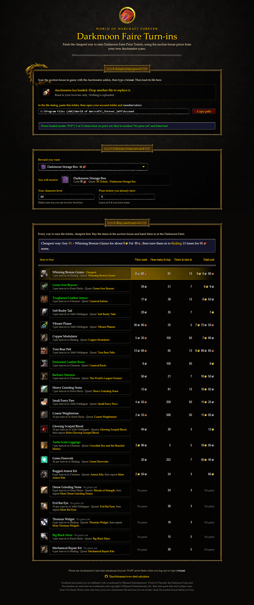
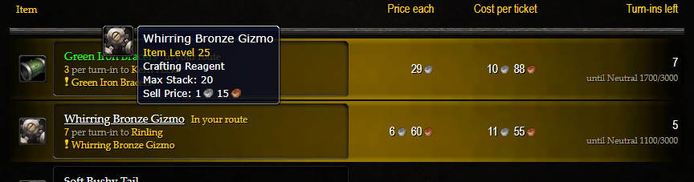

<p align="center">
  
</p>

# DMF Turn-in Calculator

Finds the cheapest Darkmoon Faire profession turn-ins (Animal Parts, Blacksmithing,
Engineering, Leatherworking) for WoW Forever, using your own Auctionator prices.

**Website: https://theoschramm.github.io/wow-dmf-calculator/**



Hover any item or quest for its in-game tooltip (from Wowhead):



## Web version (GitHub Pages)

Open the [website](https://theoschramm.github.io/wow-dmf-calculator/) (or a local copy of `index.html`),
then drop in your `Auctionator.lua`:

```
World of Warcraft\_forever_\WTF\Account\<ACCOUNT>\SavedVariables\Auctionator.lua
```

The file is parsed entirely in your browser and is never uploaded.

The page has three steps:

1. **Load your prices**: your `Auctionator.lua` (scan the auction house in game first, then `/reload`).
2. **Choose your reward**: the prize you want, your character level, any tickets you already have and your
   Darkmoon Faire reputation (default Neutral 0).
3. **Buy and turn in**: the cheapest **route**, step by step: what to buy, which NPC to hand it to and how many
   times, with your tickets and reputation after each step. Below it, every turn-in with its price, cost per
   ticket and how many turn-ins are left before its reputation limit.

The route respects reputation limits: each turn-in gives 250 Darkmoon Faire reputation, and the quests of
tiers 1-4 stop being offered at Neutral 500 / 1100 / 1700 / 2500, so the cheap low tiers can only be used a few
times and must come first. Tier 5 never closes (after Friendly 5999 its "More ..." quest gives tickets without
reputation).

## Command line

Needs [Node.js](https://nodejs.org) 16+. No dependencies.

```
node cli.js --target greater --tickets 10 --category Engineering --limit 5
```

Options: `--level`, `--tickets`, `--target` (a number or reward key: flower, minor, monthmutton, lesser, greater,
tonk, box, mutton, amulet, orb; default 50), `--rep` (Darkmoon Faire reputation in points from Neutral 0, so
Friendly 0 = 3000), `--strict-caps`, `--category`, `--limit`, `--realm`, `--file`.
With a price file it prints the cheapest route first (same planner as the website), then single-item options.
`--help` lists every reward with its ticket cost and Wowhead link.
`--ssf` is the self-found mode (see below): no price file, it plans by kills instead of gold.
It finds the newest `Auctionator.lua` under `WOW_ROOT` (env var; defaults to the Classic `_forever_` WTF path).

## Crafting your own turn-ins

Tick the professions you have (Blacksmithing, Engineering, Leatherworking) in step 1, or pass
`--prof Engineering:260,Leatherworking` to the CLI (`:skill` is optional, default 300). For those turn-ins the price becomes the cheaper of the auction
price and the price of the materials, taken from the same Auctionator file, and the route says "Craft ..." with the
materials to gather. Every material needs an Auctionator price (vendor materials such as thread and dyes too, so
scan them or they show as "Materials not priced"). Enter your skill level for each profession: recipes that need more are skipped and tagged "Needs skill N" (the skill
needs come from wiki.gg's Classic values, not confirmed for Forever). Materials are priced as they
are (a Solid Grinding Stone or Heavy Leather is not broken down further). Recipes come from Wowhead Forever;
`node tools/build-recipes.js` regenerates them in `dmf.js`.

## Self-found mode (no auction house)

Tick "Self-found" in step 1 of the page (or pass `--ssf` to the CLI) to farm the items instead of buying them.
The planner then minimises expected kills rather than gold, picking for each step the mob with the best drop
chance that you can fight at your level (up to 2 levels above you), and lists the next best mobs too.
Only the Animal Parts drop from mobs; the Blacksmithing, Engineering and Leatherworking turn-ins are crafted,
so they are left out. Drop chances are looted / times the mob was looted in Wowhead Forever's data, for normal
open-world mobs only (no elites, rares, dungeons, raids or battlegrounds, and at least 100 recorded loots).
It is not time-aware: it doesn't know how dense a mob's spawns are, only how often it drops the item.

To refresh the data, install `tools/wowhead-drops.user.js` in Tampermonkey, open each of the six Animal Parts item
pages on Wowhead Forever, click "Save drops", then "Copy all" and save the JSON as `tools/results.json`.
`node tools/build-drops.js` rewrites the `DROPS` block in `dmf.js` from it.

## Code layout

- `dmf.js` is the single source of truth: item data, level requirements, Auctionator parsing and the ranking maths.
- `index.html` (web UI) and `cli.js` (terminal) are thin front-ends over it. Edit items or rules in `dmf.js` only.
- Web UI:
  - `index.html`: page skeleton (frames and mount points only).
  - `css/styles.css`: all styling. It only places real WoW Classic UI textures (dialog frames, red panel
    buttons, edit boxes, check boxes, item slots, auction rows, highlights, coins) from `assets/ui/`.
  - `assets/ui/`: those textures, built by `python tools/build-ui-textures.py` (needs Pillow) from
    [Gethe/wow-ui-textures](https://github.com/Gethe/wow-ui-textures) (`classic` branch). The script only
    crops them, rearranges border "edge files" into 9-slice images for CSS `border-image`, and removes the
    gold dragon's tail so it doesn't reach into the frame.
    The art belongs to Blizzard Entertainment; this is a non-commercial fan tool.
  - `components/`: one file per UI piece, each a plain script that registers on `window.UI`
    (`money.js`, `wowhead.js`, `item-picker.js`, `file-loader.js`, `filters.js`, `results-table.js`). Plain scripts rather than ES modules,
    so `index.html` still works when opened straight from disk.
  - `app.js`: wires `dmf.js` to the components.
- `serve.js` only serves published files; add new top-level files to its `PUBLIC` list
  (files in `css/`, `components/` and `assets/ui/` are allowed automatically).

## Notes

- Prices are Auctionator's last seen minimum, so they're as fresh as your last in-game
  scan plus a `/reload` or logout (that's when WoW writes the file).
- There are no built-in prices. Items Auctionator has no price for are listed last as "No AH price",
  still showing the quests and items needed.
- Each turn-in item links its Wowhead quest(s); tier 5 has a first-time quest plus a repeatable "More ..." quest.
  Each goal is a real reward item, linked with the "N Tickets - ..." quest that redeems it.
  Item and quest IDs come from Wowhead's Forever data.

- Quest quantities, tiers, ticket values and reputation caps come from the
  [Warcraft Tavern DMF guide](https://www.warcrafttavern.com/forever/guides/darkmoon-faire/)
  (250 reputation per quest; caps 500/1100/1700/2500 Neutral and Friendly 5999 for tier 5), with the tier-5
  "More ..." behaviour from [Wowpedia](https://wowpedia.fandom.com/wiki/Darkmoon_Faire_(Classic)).
  [wowcalc](https://wowcalc.net/en/forever/wiki/reputations/darkmoon-faire) lists +100 for some quests using
  Classic data it says is unconfirmed for Forever; `REP_PER_QUEST` / `REP_CAP` in `dmf.js` are easy to change.
- Tier 5 Animal Parts: Evil Bat Eyes (quest 7903) and Glowing Scorpid Blood (quest 8222) are separate
  quests, so they're separate options.

## Publishing

The site is deployed to https://theoschramm.github.io/wow-dmf-calculator/ by GitHub Actions
(`.github/workflows/pages.yml`) on every push to `main`; it can also be run by hand from the Actions tab.
Only the site files are published (`index.html`, `app.js`, `dmf.js`, `css/`, `components/`, `assets/`).
Pages source must be set to "GitHub Actions" (Settings > Pages).
